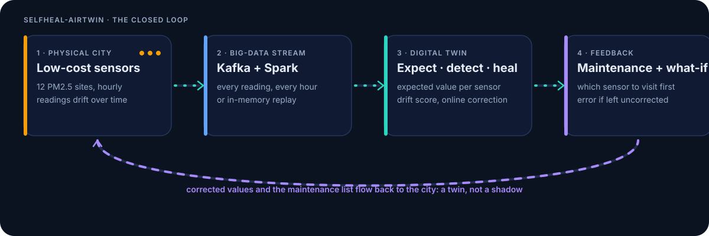
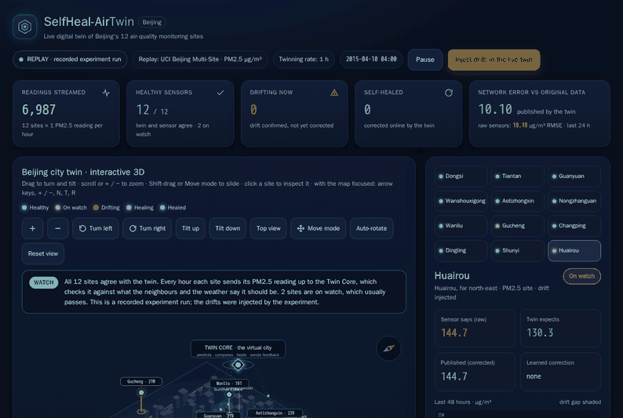
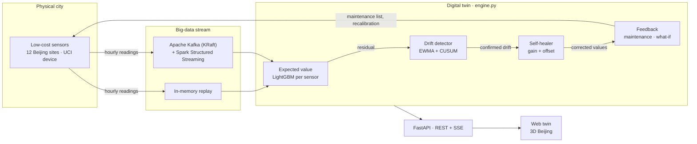
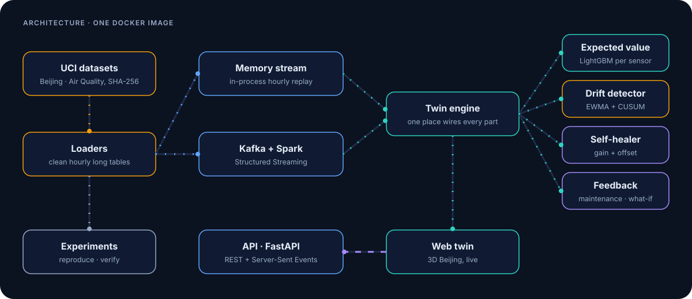

# SelfHeal-AirTwin

**A self-healing digital twin that detects drift in low-cost urban air-quality sensors, corrects it while data streams in, and tells the city which sensor to recalibrate first.**

[](https://github.com/the-sudipta/SelfHeal-AirTwin/actions/workflows/ci.yml)
[](https://github.com/the-sudipta/SelfHeal-AirTwin/releases/latest)
[](https://github.com/the-sudipta/SelfHeal-AirTwin/pkgs/container/selfheal-airtwin)
[](https://the-sudipta.github.io/SelfHeal-AirTwin/)
[](LICENSE)

<picture>
  <source media="(prefers-color-scheme: light)" srcset="assets/twin-loop-light.svg">
  
</picture>

> **Status:** under active development. Milestone `v0.9.0` adds the live twin: `docker compose up` serves an interactive 3D web twin of Beijing at `http://localhost:8080`, driven by the real pipeline over a REST and Server-Sent Events API, on the memory or the Kafka + Spark backend. The experiments of `v0.8.0` are rerun and verified by `airtwin reproduce`. README visuals, the project site and release automation follow; see [CHANGELOG.md](CHANGELOG.md).

## The problem

Cities fill the gaps between a few expensive reference stations with many low-cost air-quality sensors. These sensors drift: their readings slowly move away from the truth, and nobody notices until decisions have already been made on wrong numbers. Existing big-data air-quality work forecasts pollution well but assumes the sensor data is correct.

## What is new

- **A drift-aware twin per sensor:** a virtual entity predicts the value each sensor *should* read from neighbouring sensors, weather and the reference analyzer, and turns the residual into a smoothed drift score (EWMA and CUSUM).
- **Self-healing in the stream:** once drift is confirmed, the twin estimates an offset and gain correction online and publishes corrected values.
- **Feedback to the physical network:** a ranked maintenance list says which sensor to recalibrate first and why, and a what-if module shows how error grows if a sensor is left uncorrected. This closed loop is what makes the system a digital twin rather than a digital shadow.

## Why it matters

Air-quality alerts, traffic restrictions and health advice are only as good as the sensor data behind them. Catching and correcting drift automatically keeps low-cost networks trustworthy at a fraction of the cost of constant manual calibration.

## See it



The interactive twin of Beijing's 12 monitoring sites, replaying a recorded experiment run: **[open it on the project site](https://the-sudipta.github.io/SelfHeal-AirTwin/twin/)**. Every value is real pipeline output. Run it yourself (below) to stream the live twin, inject drift and mark sensors recalibrated.

## Quick start

Install only [Docker](https://docs.docker.com/get-docker/). The image downloads both datasets during the build, verifies their SHA-256 checksums and then runs fully offline.

```powershell
docker compose up                    # the live twin and the web twin at http://localhost:8080
docker compose --profile kafka up    # adds Apache Kafka (KRaft) and the same twin on Kafka + Spark at http://localhost:8081
docker compose run --rm twin reproduce   # reruns every experiment, rewrites results/, then verifies against the reference
```

Open `http://localhost:8080` once the log shows the server is up. The twin first replays the calibration year and the drift baseline at full speed (about 15–30 seconds), then streams one hour of Beijing data per second: an interactive 3D city with the twin's expected, raw and corrected values for the 12 PM2.5 sites, its events, the maintenance list and the what-if. Press **Inject drift** to make the selected sensor read 40 % too high and watch the twin detect it, correct it and rank it for a field visit; **Mark recalibrated** closes the loop. The API is documented at `http://localhost:8080/api/docs`. `reproduce` takes about 40–60 minutes on a laptop and ends with `PASS` when every regenerated table matches the committed reference. Generated outputs land in `./results` on your own disk.

Release images are on GitHub Container Registry; pull them by the digest in each release's `IMAGE_DIGEST.txt` (`ghcr.io/the-sudipta/selfheal-airtwin@sha256:…`), not by tag.

<details>
<summary>Without Docker (Windows PowerShell)</summary>

Inside the virtual environment from [CONTRIBUTING.md](CONTRIBUTING.md):

```powershell
$env:PYTHONPATH = "src"
python -m airtwin.cli download   # downloads both archives and checks their SHA-256
python -m airtwin.cli prepare    # writes cleaned hourly tables to data/processed/
python -m airtwin.cli serve      # the live twin at http://localhost:8080
python -m airtwin.cli reproduce  # every experiment, then verify
```

</details>

## How it works



<picture>
  <source media="(prefers-color-scheme: light)" srcset="assets/architecture-light.svg">
  
</picture>

Each hour, every sensor's reading passes the same cycle: the virtual entity predicts the expected value from neighbouring sites and the weather; the active correction turns the raw reading into the published value; the drift detector watches the residual of the published value; on confirmed drift the self-healer fits `raw = gain × expected + offset` and publishes `(raw − offset) / gain`, but only when the correction is large, clearly better and points the right way; untrusted sensors enter their neighbours' models as virtual values (trust substitution); and the maintenance list ranks the sensors to service.

| Big-data V | In SelfHeal-AirTwin |
|---|---|
| **Volume** | 420,768 hourly rows from 12 Beijing sites over four years, plus a year of UCI Air Quality; 370 seeded experiment runs |
| **Velocity** | Every reading streamed hour by hour through Apache Kafka and Spark Structured Streaming (or an in-memory replay) into the twin |
| **Variety** | Neighbouring sites' readings, weather, low-cost sensor responses and a certified reference analyzer from two datasets, combined in each sensor's expected value |
| **Veracity** | The main goal: detect drifting sensors and correct their data while it streams |
| **Value** | A ranked maintenance list, corrected published values and a what-if of the error if a sensor is not visited |

## Results

<!-- results:start -->
### UCI Air Quality (real drift): RMSE against the reference analyzer

| Sensor | Raw | One-time calibration | Rolling recalibration | Kalman gain tracking | SelfHeal-AirTwin |
|---|---|---|---|---|---|
| s1_co | 0.86 | 1.13 | 0.70 | 0.73 | 0.72 |
| s2_nmhc | 1.45 | 1.46 | 1.61 | 1.65 | 1.46 |
| s3_nox | 194.09 | 186.92 | 162.21 | 214.60 | 221.57 |
| s4_no2 | 62.95 | 59.11 | 32.80 | 38.75 | 39.35 |

### Beijing PM2.5 (injected drift, years 3-4): detection, mean over runs

| Drift | Runs | Recall | Precision | False alarms / 1,000 h | Median delay (h) |
|---|---|---|---|---|---|
| exponential | 30 | 1.00 | 0.03 | 0.56 | 1268 |
| linear | 30 | 1.00 | 0.03 | 0.49 | 742 |
| step | 30 | 1.00 | 0.03 | 0.52 | 150 |

### Beijing PM2.5: RMSE of published values, drifting sensors (µg/m³, mean [95% CI])

| Drift | Raw | One-time calibration | Rolling recalibration | Kalman gain tracking | SelfHeal-AirTwin |
|---|---|---|---|---|---|
| exponential | 35.8 [34.0, 37.6] | 33.5 [31.3, 35.8] | 18.4 [17.1, 19.6] | 13.2 [12.1, 14.3] | 19.1 [17.4, 20.9] |
| linear | 39.5 [37.3, 41.7] | 37.9 [35.6, 40.1] | 17.8 [16.6, 19.1] | 13.4 [12.0, 14.8] | 17.1 [15.3, 18.9] |
| step | 39.9 [37.6, 42.1] | 38.2 [35.6, 40.8] | 18.0 [16.8, 19.2] | 13.4 [12.2, 14.5] | 17.6 [15.8, 19.4] |

### Beijing PM2.5: RMSE of published values, healthy sensors (µg/m³, mean [95% CI])

| Drift | Raw | One-time calibration | Rolling recalibration | Kalman gain tracking | SelfHeal-AirTwin |
|---|---|---|---|---|---|
| exponential | 0.0 [0.0, 0.0] | 6.4 [6.2, 6.6] | 17.0 [16.3, 17.7] | 12.6 [12.0, 13.2] | 4.0 [3.5, 4.5] |
| linear | 0.0 [0.0, 0.0] | 6.6 [6.5, 6.8] | 17.6 [17.0, 18.2] | 12.9 [12.3, 13.4] | 3.4 [3.1, 3.7] |
| step | 0.0 [0.0, 0.0] | 6.6 [6.5, 6.8] | 17.6 [16.7, 18.5] | 13.0 [12.3, 13.8] | 3.6 [3.2, 3.9] |

### Beijing PM2.5: RMSE of published values, all sensors (µg/m³, mean [95% CI])

| Drift | Raw | One-time calibration | Rolling recalibration | Kalman gain tracking | SelfHeal-AirTwin |
|---|---|---|---|---|---|
| exponential | 7.2 [6.8, 7.7] | 11.6 [11.2, 12.1] | 17.1 [16.6, 17.5] | 12.5 [12.1, 12.9] | 6.9 [6.3, 7.5] |
| linear | 7.7 [7.2, 8.2] | 12.5 [11.9, 13.0] | 17.4 [16.9, 17.8] | 12.7 [12.3, 13.2] | 5.9 [5.5, 6.4] |
| step | 7.7 [7.2, 8.3] | 12.5 [11.9, 13.0] | 17.4 [16.8, 17.9] | 12.7 [12.2, 13.3] | 6.2 [5.7, 6.6] |

### Ablation (mean over runs)

| Variant | F1 | False alarms / 1,000 h | RMSE drifted | RMSE healthy | RMSE all |
|---|---|---|---|---|---|
| cusum_only | 0.06 | 0.49 | 17.8 | 3.6 | 6.3 |
| ewma_only | 0.59 | 0.02 | 22.2 | 0.9 | 5.1 |
| full | 0.06 | 0.49 | 17.8 | 3.6 | 6.3 |
| no_neighbours | 0.01 | 2.65 | 61.9 | 55.3 | 56.5 |
| no_self_healing | 0.06 | 0.47 | 37.6 | 0.0 | 7.4 |
| no_trust_substitution | 0.02 | 1.72 | 17.5 | 8.5 | 10.0 |
| no_weather | 0.06 | 0.52 | 17.1 | 3.2 | 5.9 |

All numbers are produced by `airtwin reproduce`; statistics, figures and the full tables are listed in [results/README.md](results/README.md).
<!-- results:end -->

## Reproducibility and integrity

- **One command reruns everything.** `docker compose run --rm twin reproduce` regenerates every table, statistic and figure and compares them with the committed reference value by value; CI reruns a seeded slice on every push, and each release reruns all of it inside the released image.
- **Every change is visible.** Signed commits and tags, a protected `main`, no rewritten history, actions pinned by commit, release images with build-provenance attestations and an SBOM, and SHA-256 sums for data, tables and figures. [INTEGRITY.md](INTEGRITY.md) shows how to check each one.

**Data availability.** Both datasets are public on the UCI Machine Learning Repository under CC BY 4.0: [Beijing Multi-Site Air Quality](https://archive.ics.uci.edu/dataset/501) (12 sites, hourly, 2013–2017; controlled drift-injection experiments and the web twin) and [Air Quality](https://archive.ics.uci.edu/dataset/360/air+quality) (real sensor drift with a co-located reference analyzer). Their checksums, provenance and required citations are in [data/README.md](data/README.md). **Code availability.** All code, configuration and reference results are in this repository under the MIT License; release images are on GitHub Container Registry.

## Repository map

| Folder | Purpose |
|---|---|
| [`src/airtwin/`](src/airtwin/README.md) | The Python package: data, streams, the twin, experiments, the API |
| [`web/`](web/README.md) | The interactive web twin (plain HTML, CSS, ES modules) |
| [`site/`](site/README.md) | The GitHub Pages project site and the recorded replay |
| [`configs/`](configs/README.md) | The one configuration file with every tunable value |
| [`data/`](data/README.md) | Dataset provenance, licences, checksums |
| [`results/`](results/README.md) | Reference tables, checksums and where every result comes from |
| [`tests/`](tests/README.md) | One test file per module |
| [`assets/`](assets/README.md) | README and site visuals |
| [`.github/`](.github/README_FILE.md) | CI, Pages and Release workflows, contributor forms |

## Roadmap

| Release | Content |
|---|---|
| v0.1.0 | Repository foundation, signed history, CI |
| v0.2.0 | Verified data download, loaders, cleaning |
| v0.3.0 | Stream interface and in-memory backend |
| v0.4.0 | Docker image, Kafka and Spark backend |
| v0.5.0 – v0.7.0 | Twin state, expected-value model, drift detector, self-healer, feedback, what-if |
| v0.8.0 | Experiments, baselines, statistics, verification |
| v0.9.0 | API and interactive web twin |
| v0.10.0 | Visuals, project site, release automation |
| v1.0.0 | Full reproduction run and final results |

## How to cite

If you use this software, please cite it using [CITATION.cff](CITATION.cff) (GitHub's "Cite this repository" button gives APA and BibTeX). Released under the [MIT License](LICENSE).

**Acknowledgements.** The data come from the UCI Machine Learning Repository: Chen, S. (2017), *Beijing Multi-Site Air Quality*, [doi:10.24432/C5RK5G](https://doi.org/10.24432/C5RK5G), with Zhang et al. (2017), *Proc. R. Soc. A* 473: 20170457; and Vito, S. (2008), *Air Quality*, [doi:10.24432/C59K5F](https://doi.org/10.24432/C59K5F), with De Vito et al. (2008), *Sensors and Actuators B* 129(2): 750–757.
